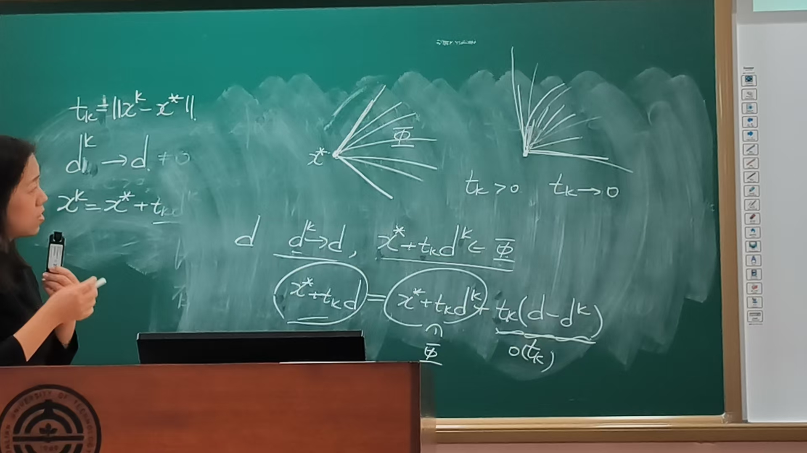
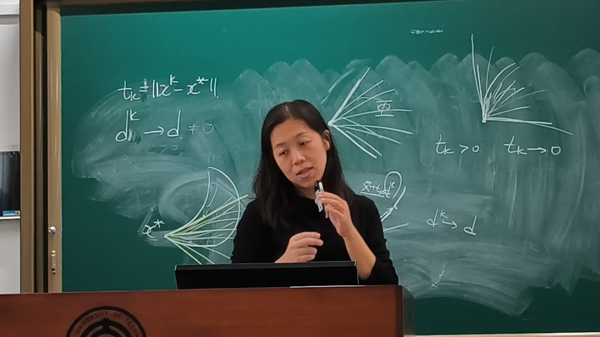

## nonlinear programming (NLP)

考虑如下的非线性规划问题：

\[
\begin{aligned}
\min \quad & f(x) \\
\text{s.t.} \quad & h_i(x) = 0, \quad i = 1, 2, \cdots, q, \\
& g_j(x) \leq 0, \quad j = 1, 2, \cdots, p.
\end{aligned}
\]

- $ f, h_i, g_j : \mathbb{R}^n \to \mathbb{R} $
- $ h_i(x) = 0, \ i = 1, 2, \cdots, q $ **等式约束**
- $ g_j(x) \leq 0, \ j = 1, 2, \cdots, p $ **不等式约束**
- $ \Phi = \{ x \mid h_i(x) = 0,\ i = 1, 2, \cdots, q,\ g_j(x) \leq 0,\ j = 1, 2, \cdots, p \} $ **可行集**

## 无约束优化的最优性条件

回顾：对于无约束优化问题 $ \min_{x \in \mathbb{R}^n} f(x) $

- **一阶必要性条件**：若 $ x^* $ 是问题的局部极小值点，其中 $ f : \mathbb{R}^n \to \mathbb{R} $ 连续可微，则 $ \nabla f(x^*) = 0 $。

- **二阶必要性条件**：若 $ x^* $ 是问题的局部极小值点，其中 $ f : \mathbb{R}^n \to \mathbb{R} $ 二次连续可微，则

\[
\nabla f(x^*) = 0, \quad \nabla^2 f(x^*) \text{ 是半正定的}.
\]

- **二阶充分性条件**：若 $ f : \mathbb{R}^n \to \mathbb{R} $ 二次连续可微，满足 $ \nabla f(x^*) = 0 $，$ \nabla^2 f(x^*) $ 是正定的，则在 $ x^* $ 处 $ f $ 的二阶增长条件成立。

（NLP）的最优性条件？
## 等式约束优化的必要最优性条件

首先考虑下述等式约束优化问题：

\[
\begin{aligned}
\min \quad & f(x) \\
\text{s.t.} \quad & h_i(x) = 0, \quad i = 1, 2, \cdots, q. \tag{1}
\end{aligned}
\]

### 一、二阶必要性条件

设 $ f, h $ 在 $ x^* $ 附近是连续可微的，$ x^* $ 是问题 (1) 的局部极小点，$ \{\nabla h_1(x^*), \cdots, \nabla h_q(x^*)\} $ 线性无关，则存在唯一的 $ \lambda^* \in \mathbb{R}^q $ 满足

\[
\nabla_x L(x^*, \lambda^*) = 0, \tag{2}
\]

其中 $ L(x, \lambda) = f(x) + \sum_{j=1}^{q} \lambda_j h_j(x) $。进一步，若 $ f, h $ 在 $ x^* $ 附近二次连续可微，则还有

\[
d^T \nabla_{xx}^2 L(x^*, \lambda^*)\, d \geq 0 \tag{3}
\]

对任何满足 $ \nabla h_j(x^*)^T d = 0,\ j = 1, 2, \cdots, q $ 的 $ d $ 是成立的。

## 证明

从而有

\[
\| h(x^k) \|^2 \leq \frac{2\left[ f(x^*) - f(x^k) \right]}{k} \leq \frac{2\left[ f(x^*) - \gamma_\epsilon \right]}{k}, \tag{4}
\]

其中 $ \gamma_\epsilon $ 是下述优化问题的最小值

\[
\begin{aligned}
\min \quad & f(x), \\
\text{s.t.} \quad & x \in B(x^*, \epsilon).
\end{aligned}
\]

对 (4) 式两端令 $ k \to +\infty $，有 $ \| h(x^k) \| \to 0 $。

设 $ \tilde{x} $ 是 $ \{x^k\} $ 的任意聚点，则存在 $ x^{k_i} \to \tilde{x} \in B(x^*, \epsilon) $，从而有 $ h(\tilde{x}) = 0 $，即 $ \tilde{x} \in \Phi $。类似上面的讨论，在 $ x^{k_i} $ 处有

\[
f(x^{k_i}) + \frac{k}{2} \sum_{j=1}^{q} h_j(x^{k_i})^2 + \frac{\alpha}{2} \|x^{k_i} - x^*\|^2 \leq f(x^*).
\]

当然有

\[
f(x^{k_i}) + \frac{\alpha}{2} \|x^{k_i} - x^*\|^2 \leq f(x^*).
\]
## 证明

对上式两端令 $ k \to +\infty $，有

\[
f(\tilde{x}) + \frac{\alpha}{2} \|\tilde{x} - x^*\|^2 \leq f(x^*).
\]

故有 $ \tilde{x} = x^* $。由于 $ \tilde{x} $ 是 $ \{x^k\} $ 的任意聚点，所以必有序列 $ \{x^k\} $ 的极限为 $ x^* $。当 $ k $ 充分大时，有 $ x^k \in \operatorname{int} B(x^*, \epsilon) $，从而 $ x^k $ 是 $ \min F_k(x) $ 的局部极小点。根据无约束优化的必要条件结论，得到

\[
\nabla F_k(x^k) = 0, \quad \nabla^2 F_k(x^k) \succeq 0,
\]

其中 $ \nabla F_k(x) $、$ \nabla^2 F_k(x) $ 有如下形式

\[
\nabla F_k(x) = \nabla f(x) + k\,Jh(x)^T h(x) + \alpha(x - x^*), \tag{5}
\]

\[
\nabla^2 F_k(x) = \nabla^2 f(x) + k \sum_{i=1}^{q} h_i(x) \nabla^2 h_i(x) + k\,Jh(x)^T Jh(x) + \alpha I. \tag{6}
\]

而 (5) 和 (6) 中 $ h(x) $ 和 $ Jh(x) $ 的定义为

\[
h(x) = \left[ h_1(x), h_2(x), \cdots, h_q(x) \right], \tag{7}
\]

\[
Jh(x) = \left[ \nabla h_1(x), \nabla h_2(x), \cdots, \nabla h_q(x) \right]^T. \tag{8}
\]

## 证明

由于 $ \nabla F_k(x^k) = 0 $，令 $ y^k = k\,h(x^k) $，由 (5) 式有

\[
Jh(x^k)^T y^k = -\nabla f(x^k) - \alpha(x^k - x^*).
\]

上式两端同时左乘 $ Jh(x^k) $，由于 $ \{\nabla h_1(x^*), \cdots, \nabla h_q(x^*)\} $ 线性无关和 $ Jh(x) $ 的定义，对充分大的 $ k $ 有 $ Jh(x^k)Jh(x^k)^T $ 非奇异，从而有

\[
y^k = -\left[ Jh(x^k)Jh(x^k)^T \right]^{-1} Jh(x^k)\left( \nabla f(x^k) + \alpha(x^k - x^*) \right).
\]

令上式两端 $ k \to +\infty $，则

\[
y^k \to \lambda^* := -\left[ Jh(x^*)Jh(x^*)^T \right]^{-1} Jh(x^*)\nabla f(x^*).
\]

由于 $ \nabla F_k(x^k) = 0 $，即 $ \nabla f(x^k) + Jh(x^k)^T y^k + \alpha(x^k - x^*) = 0 $。令 $ k \to +\infty $，则 $ \nabla f(x^*) + Jh(x^*)^T \lambda^* = 0 $。即 $ \nabla_x L(x^*, \lambda^*) = 0 $。

**乘子唯一性**：设 $ \lambda_1, \lambda_2 \in \mathbb{R}^q $ 均满足一阶条件

\[
\nabla f(x^*) + Jh(x^*)^T \lambda_i = 0, \quad i = 1, 2.
\]

两式相减，得 $ Jh(x^*)^T (\lambda_1 - \lambda_2) = 0 $。由于 $ \{\nabla h_1(x^*), \cdots, \nabla h_q(x^*)\} $ 线性无关，矩阵 $ Jh(x^*) $ 行满秩，故 $ Jh(x^*)^T $ 列满秩。因此 $ \lambda_1 - \lambda_2 = 0 $，即乘子唯一。

## 证明

下面来证明 (3) 式成立。首先回顾一下线性代数的有关结论。考虑

\[
\ker A = \{ x \in \mathbb{R}^n : Ax = 0 \},
\]

其中 $ A \in \mathbb{R}^{m \times n} $ 行满秩，则对任意的 $ x \in \ker A $，存在向量 $ \xi $ 使得

\[
x = P\xi, \quad \text{其中 } P = I - A^T(AA^T)^{-1}A. \tag{9}
\]

故对任何 $ d $ 满足 $ Jh(x^*)d = 0 $，存在 $ \xi \in \mathbb{R}^n $ 满足 $ d = P(x^*)\xi $，其中

\[
P(x) = I - Jh(x)^T\left( Jh(x)Jh(x)^T \right)^{-1} Jh(x), \quad x \in B(x^*, \epsilon_1),
\]

$ \epsilon_1 \in (0, \epsilon) $ 满足：对任何 $ x \in B(x^*, \epsilon_1) $，$ Jh(x) $ 是行满秩的。令

\[
d^k = P(x^k)\xi, \quad \text{则 } d^k \to d.
\]

注意 $ Jh(x^k)d^k = 0 $，$ \nabla^2 F_k(x^k) \succeq 0 $，$ (d^k)^T \nabla_{xx}^2 F(x^k) d^k \geq 0 $。由 (6) 得到

\[
(d^k)^T \nabla_{xx}^2 L(x^k, y^k) d^k + \alpha \|d^k\|^2 \geq 0,
\]

令 $ k \to +\infty $，有 $ d^T \nabla_{xx}^2 L(x^*, \lambda^*) d + \alpha \|d\|^2 \geq 0 $。由于 $ \alpha $ 的任意性，有

\[
d^T \nabla_{xx}^2 L(x^*, \lambda^*) d \geq 0.
\]

证毕。

(这种必要条件$\geq $0,充分条件>0的成对条件在优化方法中称为无间隙的条件)

## 二阶充分性条件

设 $ x^* $ 是等式约束优化问题 (1) 的可行点，存在 $ \lambda $ 使

\[
\nabla_x L(x^*, \lambda) = \nabla f(x^*) + Jh(x^*)^T \lambda = 0
\]

成立。（此时，称 $ x^* $ 为 **KKT 点**，$ (x^*, \lambda) $ 为 **KKT 对**）
同时对任何 $ 0 \neq d \in \ker Jh(x^*) $ 满足

\[
d^T \nabla_{xx}^2 L(x^*, \lambda) d > 0, \tag{10}
\]

则在 $ x^* $ 处二阶增长条件成立。

**证明.** 反证法。假设二阶增长条件不成立，则存在 $ c_k \downarrow 0 $ 和 $ x^k \in \Phi \setminus \{x^*\} $，使得 $ x^k \to x^* $ 且

\[
f(x^k) - f(x^*) \leq c_k \| x^k - x^* \|^2. \tag{11}
\]

令 $ t_k = \| x^k - x^* \| $，$ d^k = \dfrac{x^k - x^*}{t_k} $，$ x^k = x^* + t_k d^k $。由于 $ \| d^k \| = 1 $，不妨取子列使 $ d^k \to d $，于是 $ \| d \| = 1 $。

由 $ h_i(x^k) = h_i(x^*) = 0 $ 及一阶 Taylor 展开，

\[
0 = h_i(x^k) = h_i(x^*) + t_k \nabla h_i(x^*)^T d^k + o(t_k).
\]

除以 $ t_k $ 并令 $ k \to \infty $，得到 $ \nabla h_i(x^*)^T d = 0 $。因此 $ d \in \ker Jh(x^*) $ 且 $ d \neq 0 $。

对 $ f $ 在 $ x^* $ 处作二阶 Taylor 展开，由 (11) 得

\[
t_k \nabla f(x^*)^T d^k + \frac{t_k^2}{2} (d^k)^T \nabla^2 f(x^*) d^k + o(t_k^2) \leq c_k t_k^2. \tag{12}
\]

同样，由 $ h_i(x^k) = h_i(x^*) = 0 $，有

\[
0 = h_i(x^k) = h_i(x^*) + t_k \nabla h_i(x^*)^T d^k + \frac{t_k^2}{2} (d^k)^T \nabla^2 h_i(x^*) d^k + o(t_k^2). \tag{13}
\]

以 $ \lambda_i $ 乘式 (13)，对 $ i = 1, \dots, q $ 求和，再加到式 (12)，得到

\[
\begin{aligned}
& t_k \left[ \nabla f(x^*) + \sum_{i=1}^{q} \lambda_i \nabla h_i(x^*) \right]^T d^k + \frac{t_k^2}{2} (d^k)^T \left[ \nabla^2 f(x^*) \right. \\
& \qquad \left. + \sum_{i=1}^{q} \lambda_i \nabla^2 h_i(x^*) \right] d^k + o(t_k^2) \leq c_k t_k^2.
\end{aligned}
\]

由驻点条件 $ \nabla_x L(x^*, \lambda) = 0 $，除以 $ t_k^2 $ 后令 $ k \to \infty $，可得

\[
\frac{1}{2} d^T \nabla_{xx}^2 L(x^*, \lambda) d \leq 0.
\]

这与二阶充分性条件对非零向量 $ d \in \ker Jh(x^*) $ 要求 $ d^T \nabla_{xx}^2 L(x^*, \lambda) d > 0 $ 矛盾。因此二阶增长条件成立.

这个从左上到右下的符号表示的是t_{k}>0,t_{k}\to 0,但是并不表示t_{k}是单调的

### 引理

设 $A \in \Re^{m\times n}$, $H \in \Re^{n\times n}$.

(i) 如果满足 $Ad=0$ 的任意向量 $d$, 有 $d^THd \ge 0$, 则 $Z^THZ$ 是半正定的, 其中 $\operatorname{Range}Z = \ker A$.

(ii) 如果满足 $Ad=0$ 的任意向量 $d \ne 0$, 有 $d^THd > 0$, 则 $Z^THZ$ 是正定的, 其中 $\operatorname{Range}Z = \ker A$, $Z$ 是列满秩的.

**这个所谓的切锥描述的就是所有允许的一阶运动方向(需要注意切线是包含在切锥里面的)**

### 切锥

先考虑一般的抽象约束问题

$$
\begin{aligned}
\min \quad & f(x) \\
\text{s.t.} \quad & x \in \Phi,
\end{aligned}
\tag{14}
$$

其中 $\Phi \subset \Re^n$ 是闭集合, $f: \Re^n \to \Re$ 是实值函数.
集合 $\Phi$ 在 $x^*$ 处的切锥定义为

$$
\begin{aligned}
T_{\Phi}(x^*) &= \left\{ d : \exists t_k \searrow 0,\ \operatorname{dist}(x^* + t_k d, \Phi) = o(t_k) \right\} \\
&= \left\{ d : \exists t_k \searrow 0,\ \exists d^k \to d,\ x^* + t_k d^k \in \Phi \right\}.
\end{aligned}
\tag{15}
$$

### 几何最优性条件

**引理** 设 $x^* \in \Phi$ 是问题 (14) 的局部极小点, $f: \Re^n \to \Re$ 在 $x^*$ 附近是连续可微的, 则

$$
\nabla f(x^*)^T d \ge 0, \quad \forall\, d \in T_{\Phi}(x^*).
$$

注: 等价地,

$$
T_{\Phi}(x^*) \cap \left\{ d : \nabla f(x^*)^T d < 0 \right\} = \emptyset.
$$

即: 目标函数的严格下降方向与切锥没有交集.

**证明.**

### Mangasarian-Fromovitz 约束规范 (MFCQ)

考虑下述非线性规划问题:

$$
\begin{aligned}
\min \quad & f(x) \\
\text{s.t.} \quad & h_i(x) = 0, \quad i = 1, 2, \cdots, q, \\
& g_j(x) \le 0, \quad j = 1, 2, \cdots, p.
\end{aligned}
\tag{16}
$$

记

$$
h(x) = \begin{bmatrix} h_1(x) \\ \vdots \\ h_q(x) \end{bmatrix}, \qquad
g(x) = \begin{bmatrix} g_1(x) \\ \vdots \\ g_p(x) \end{bmatrix}.
$$

可行域 $\Phi = \{x : h(x) = 0,\ g(x) \le 0\}$.

**MFCQ**

称 $\Phi$ 在 $x^*$ 处 MF 约束规范成立, 如果

(1) $\nabla h_1(x^*), \cdots, \nabla h_q(x^*)$ 线性无关.

(2) 存在 $d^*$ 满足:
$$
\nabla h_i(x^*)^T d^* = 0, \ i = 1, 2, \cdots, q; \quad \nabla g_j(x^*)^T d^* < 0, \ j \in I(x^*),
$$
其中 $I(x^*) = \{j : g_j(x^*) = 0,\ j = 1, 2, \cdots, p\}$.

### 约束集合的切锥(线性化可行方向锥)
**约束集合的切锥**

若 $x^* \in \Phi$ 处 MF 约束规范成立, 则

$$
T_{\Phi}(x^*) = \left\{ d : Jh(x^*)d = 0,\ \nabla g_i(x^*)^T d \le 0,\ i \in I(x^*) \right\} := L_{\Phi}(x^*).
$$

$L_{\Phi}(x^*)$ 称为 $x^* \in \Phi$ 处的线性化可行方向锥.

证略.

注: 一般的, $T_{\Phi}(x^*) \subseteq L_{\Phi}(x^*)$.

**例 ($T_\Phi \neq L_\Phi$).** 考虑被两条抛物线夹成的非凸集合
$$
\Phi = \big\{ x=(x_1,x_2)\in\Re^2 : x_1^2 \le x_2 \le 2x_1^2 \big\},\qquad x^*=(0,0).
$$
在 $x^*$ 处两个约束都取等号:
$$
g_1(x)=x_1^2-x_2\le 0,\quad \nabla g_1(x^*)=(0,-1);\qquad
g_2(x)=x_2-2x_1^2\le 0,\quad \nabla g_2(x^*)=(0,1).
$$
- 线性化锥:
  $$
  L_{\Phi}(x^*) = \{ d : -d_2\le 0,\ d_2\le 0\} = \{ d : d_2=0\},
  $$
  即整条 $x_1$ 轴.
- 切锥: 沿方向 $d=(d_1,d_2)$, 需对任意小 $t>0$ 有
  $$
  t d_1^2 \le d_2 \le 2t d_1^2.
  $$
  令 $t\to 0^+$ 两端皆趋于 $0$, 强制 $d_2=0$; 若再取 $d_1\neq 0$ 则左端 $t d_1^2\le 0$ 要求 $d_1=0$. 故
  $$
  T_{\Phi}(x^*) = \{0\}\ \subsetneq\ L_{\Phi}(x^*).
  $$
注: 此处 MFCQ 不成立 (要求存在 $d^*$ 使 $-d_2^*<0$ 且 $d_2^*<0$, 不可能), 正说明只有 MFCQ 成立时才有 $T_\Phi=L_\Phi$; 而 $L_\Phi$ 仅做一阶线性近似, 看不到二阶的"夹缝"阻挡, 故比 $T_\Phi$ 大. (凸可行域必有 $T_\Phi=L_\Phi$.)

**推论** 若 $f(x): \Re^n \to \Re$ 在 $x^*$ 的附近是连续可微的, $x^*$ 是 (16) 的局部最优解且在 $x^* \in \Phi$ 处 MFCQ 成立, 则

$$
\nabla f(x^*)^T d \ge 0, \quad \forall\, d \in L_{\Phi}(x^*).
$$

### NLP 的 Lagrange 乘子集

**Lagrange 乘子集**

Lagrange 函数: $L(x, \mu, \lambda) = f(x) + \mu^T h(x) + \lambda^T g(x)$.

Lagrange 乘子集合:
$$
\Lambda(x^*) = \left\{ (\mu, \lambda) : \begin{array}{l} \nabla_x L(x^*, \mu, \lambda) = 0, \\ 0 \le \lambda \perp g(x^*) \le 0. \end{array} \right\}
$$

其中 $\nabla_x L(x^*, \mu, \lambda) = \nabla f(x^*) + Jh(x^*)^T \mu + Jg(x^*)^T \lambda$.

**广义 Lagrange 乘子集**

广义 Lagrange 函数: $L^g(x, \lambda_0, \mu, \lambda) = \lambda_0 f(x) + \mu^T h(x) + \lambda^T g(x)$.

广义 Lagrange 乘子集合为
$$
\Lambda^g(x^*) = \left\{ (\lambda_0, \mu, \lambda) : \begin{array}{l} \nabla_x L^g(x^*, \lambda_0, \mu, \lambda) = 0, \\ 0 \ne (\lambda_0, \lambda) \ge 0,\ \lambda^T g(x^*) = 0. \end{array} \right\}
$$

其中 $\nabla_x L^g(x^*, \lambda_0, \mu, \lambda) = \lambda_0 \nabla f(x^*) + Jh(x^*)^T \mu + Jg(x^*)^T \lambda$.

若一广义 Lagrange 乘子 $(\lambda_0, \lambda)$ 满足 $\lambda_0 = 0$, 则称 $\lambda$ 是一奇异 Lagrange 乘子.

### NLP 的一阶必要性条件

**NLP 的一阶必要性条件**

设 $x^*$ 是局部最优解, 则 $\Lambda^g(x^*)$ 非空, 且下述条件等价:

1. $x^*$ 处 MFCQ 成立.
2. 奇异 Lagrange 乘子集合是空集.
3. $\Lambda(x^*)$ 非空有界的.

证略.

**线性无关约束规范 (LICQ)**

称在 $x^* \in \Phi$ 处的线性无关约束规范 (LICQ) 成立, 如果

$$
\{\nabla h_1(x^*), \cdots, \nabla h_q(x^*)\} \cup \{\nabla g_i(x^*),\ i \in I(x^*)\}
$$

是线性无关的.

## LICQ 与 MFCQ 的关系

### LICQ $\Rightarrow$ MFCQ

**证明.** 显然 MFCQ 的条件 (1) 成立. 考虑如下方程组

$$
\begin{cases}
Jh(x^*)z = 0, \\
Jg_{I(x^*)}(x^*)z = -\mathbf{1}_{|I(x^*)|},
\end{cases} \tag{17}
$$

其中 $\mathbf{1}_{|I(x^*)|} = (1, 1, \cdots, 1)^T$, 其分量的个数为 $|I(x^*)|$.

令

$$
A = \begin{bmatrix}
Jh(x^*) \\
Jg_{I(x^*)}(x^*)
\end{bmatrix},
\quad
b = \begin{bmatrix}
0 \\
-\mathbf{1}_{I(x^*)}
\end{bmatrix},
$$

则 (17) 变为 $Az = b$. 由 LICQ 的条件知 $A$ 行满秩. 从而上式存在非零解 $z = A^T(AA^T)^{-1}b$, 故 MFCQ 的条件 (2) 成立.

### MFCQ $\not\Rightarrow$ LICQ

**反例.** 令

$$
\begin{cases}
g_1(x) = 2 - (x_1 - 1)^2 - (x_2 - 1)^2 \ge 0 \\
g_2(x) = 2 - (x_1 - 1)^2 - (x_2 + 1)^2 \ge 0 \\
g_3(x) = x_1 \ge 0
\end{cases}
$$

考虑 $x^* = (0, 0)^T$, 则 $I(x^*) = \{1, 2, 3\}$, $x^*$ 处 LICQ 不成立. 取 $d^* = (1, 0)^T$, 则 $x^*$ 处 MFCQ 成立.

## KKT 条件

$x^*$ 处的 KKT 条件 ($\mu, \lambda$ 为 lagrange 乘子(或 KKT 乘子))

$$
\begin{cases}
\nabla f(x^*) + Jh(x^*)^T\mu + Jg(x^*)^T\lambda = 0, \\
h(x^*) = 0, \\
0 \le \lambda \perp -g(x^*) \ge 0,
\end{cases} \tag{18}
$$

### 约束规范失效的例子

考虑 $\min_x f(x) = x$, s.t. $g(x) = x^2 \le 0$. 可行集 $\Phi = \{0\}$, 故 $x^* = 0$ 是局部最优点, 但

$$
T_{\Phi}(0) = \{0\}, \qquad L_{\Phi}(0) = \Re, \qquad \nabla g(0) = 0,
$$

MFCQ 不成立. 若存在 KKT 乘子, 则要求

$$
\nabla f(0) + \lambda \nabla g(0) = 1 + \lambda \cdot 0 = 0,
$$

矛盾. 因此局部最优点处未必有通常的 KKT 乘子.

## Examples

### (1)

$$
\begin{cases}
\min & c^T x \\
\text{s.t.} & Ax \ge b,
\end{cases}
$$

问题的 Lagrange 函数为 $L(x, \lambda) = c^T x + \lambda^T(b - Ax)$. KKT 条件为

$$
\begin{cases}
c - A^T \lambda = 0, \\
0 \le \lambda \perp (Ax - b) \ge 0.
\end{cases}
$$

上述 KKT 条件等价于

$$
\begin{cases}
c - A^T \lambda = 0, \\
Ax - b - s = 0, \\
0 \le \lambda \perp s \ge 0.
\end{cases}
$$

### (4)

$$
\begin{cases}
\min & c^T x + \dfrac{1}{2} x^T G x, \\
\text{s.t.} & Ax - b \ge 0.
\end{cases}
$$

问题的 Lagrange 函数为 $L(x, \lambda) = c^T x + \dfrac{1}{2} x^T G x - \lambda^T(Ax - b)$. KKT 条件为

$$
\begin{cases}
c + Gx - A^T \lambda = 0, \\
0 \le \lambda \perp Ax - b \ge 0.
\end{cases}
$$

## 凸优化问题中的 KKT 充分性

对于非线性规划问题 (16), 设 $f, g_j$ 为凸函数, $h_i$ 为仿射函数, 则该问题为凸优化问题. 此时有

**定理**

若凸优化问题 (16) 在可行点 $x^*$ 处存在乘子 $(\mu^*, \lambda^*)$ 满足 KKT 条件, 则 $x^*$ 是全局最优解.

**证明:** 对任意可行点 $x$, 由 $L$ 关于 $x$ 的凸性和 $\nabla_x L(x^*, \mu^*, \lambda^*) = 0$, 有

$$
L(x, \mu^*, \lambda^*) \ge L(x^*, \mu^*, \lambda^*) = f(x^*).
$$

又因 $h(x) = 0$, $g(x) \le 0$, $\lambda^* \ge 0$, 有 $f(x) \ge L(x, \mu^*, \lambda^*) \ge f(x^*)$.

**注:** 反之, 若 $x^*$ 是问题 (16) 的最优解, 且该点处 slater 条件成立, 即存在 $\bar{x}$ 使

$$
h(\bar{x}) = 0, \qquad g_j(\bar{x}) < 0 \quad (j = 1, \cdots, p),
$$

则 $x^*$ 为问题的 KKT 点.

到补充练习了

## 定理 5.3.1

$$
\begin{aligned}
& A = I + B, \\
& \operatorname{rank}(B) = r, \\
& \operatorname{span}\{r_0, Ar_0, \cdots, A^k r_0\} = \operatorname{span}\{r_0, Br_0, \cdots, B^k r_0\}.
\end{aligned}
$$

（可证明 $\dim \le r + 1$。）

> 注：这个东西在 CMC 中应该比较有用。
